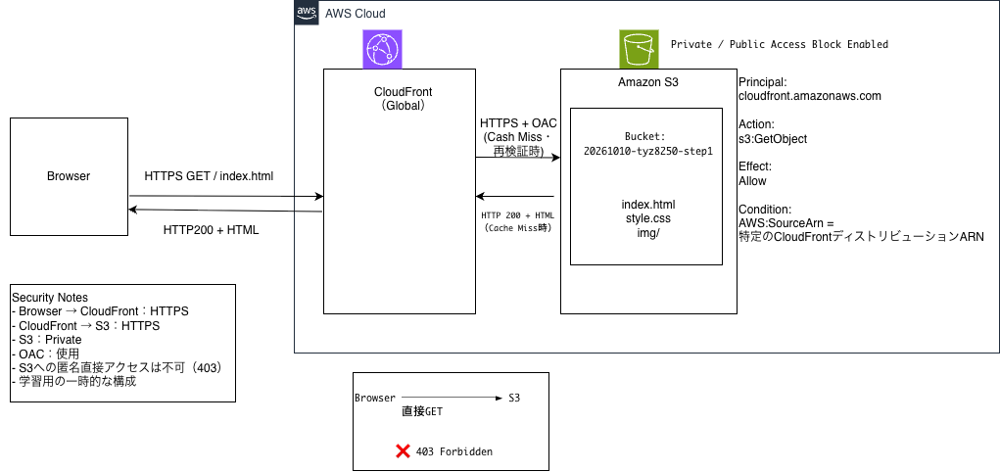

# Cloud Native Bootcamp

AWS公式の「実践力を鍛えるBootcamp - クラウドネイティブ編」を参考に、AWSの設計・構築・セキュリティ・運用を学習するプロジェクトです。

単にAWSサービスを構築するだけでなく、構成変更の理由、アクセス制御、検証結果、トラブルシューティングを記録しています。

## Architecture

### 現在の構成：CloudFront + OAC + Private S3

**構成概要**

- Amazon S3：HTML・CSS・画像などの静的ファイルを保存
- Amazon CloudFront：HTTPS配信とコンテンツのキャッシュ
- Origin Access Control（OAC）：CloudFrontからS3への署名付きアクセス
- S3バケットポリシー：指定したCloudFrontディストリビューションに読み取り権限を付与

### Architecture Evolution

今回の構成は、以下の順番で改善しました。

| Phase | アーキテクチャ | 学習内容 |
|---|---|---|
| 1 | Public S3 | 静的Webサイトホスティング・アクセス制御 |
| 2 | CloudFront + Public S3 | CDN・キャッシュ・HTTPS |
| 3 | CloudFront + OAC + Private S3 | 認証・認可・最小権限 |

各段階の構成図と検証結果は[学習ログ](docs/learning-log.md)に記録しています。

## Verification

### CloudFront Cache

`/css/style.css` に対してキャッシュの動作を確認しました。

| 項目 | 検証結果 |
|---|---|
| 初回アクセス | `Miss from cloudfront` |
| 再アクセス | `Hit from cloudfront` |
| Ageヘッダー | `470` |
| Edge Location | `KIX82-P7` |

ブラウザキャッシュとCloudFrontキャッシュの保存場所・再利用範囲が異なることも学びました。

### Security

S3を非公開化し、CloudFront経由でのみコンテンツを配信する構成に変更しました。

| アクセス経路 | 結果 |
|---|---|
| CloudFront → S3 | `200 OK` |
| S3への匿名直接アクセス | `403 Forbidden` |
| CloudFront Invalidation後 | `200 OK` |

CloudFrontのOACとS3バケットポリシーを組み合わせることで、S3を一般公開せずにコンテンツを配信できることを検証しました。

## Project Status

### Completed

- [x] S3 Static Website Hosting
- [x] CloudFront Distribution
- [x] Cache Hit / Miss Verification
- [x] S3 Public Access Block
- [x] CloudFront OAC
- [x] S3 Bucket Policy
- [x] CloudFront Cache Invalidation
- [x] Architecture Diagrams

### Next

- [ ] 独自ドメイン・HTTPS設定（任意）
- [ ] 次のBootcamp課題
- [ ] TerraformによるIaC化
- [ ] CI/CDの構築
- [ ] 監視・ログ・障害調査

## Documentation

- [学習ログ](docs/learning-log.md)
- [トラブルシューティング](docs/troubleshooting.md)
- [アーキテクチャ設計メモ](docs/architecture.md)

## References

- [AWS公式：実践力を鍛えるBootcamp - クラウドネイティブ編](https://catalog.us-east-1.prod.workshops.aws/workshops/a9b0eefd-f429-4859-9881-ce3a7f1a4e5f/ja-JP)
- [AWS公式：CloudFront OAC](https://docs.aws.amazon.com/ja_jp/AmazonCloudFront/latest/DeveloperGuide/private-content-restricting-access-to-s3.html)

## Notes

本リポジトリは個人学習の成果物です。

AWS公式ワークショップを参考にしていますが、公式教材そのものの転載ではなく、自身で作成した構成図、検証結果、学習記録を掲載しています。

AWSリソースの構築・利用には料金が発生する場合があります。