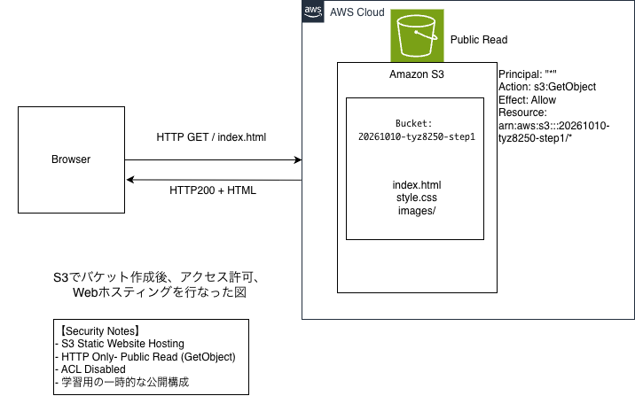
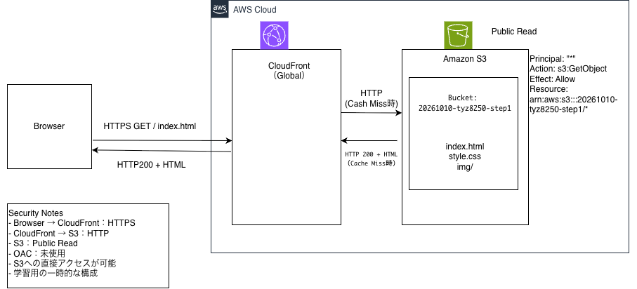

# Cloud Native Bootcamp 学習ログ

## Step 1：Web Hosting_

### 今日やったこと
- S3のバケットを作成
- S3で静的Webサイトをホスト

### 理解したこと
- ACLを無効にしたら、別のAWSアカウントBがオブジェクトをアップロードしても、所有者はバケットを持つAWSアカウントAになる。
- S3をパブリック公開しなくても、CloudFront経由でWebサイトを一般公開できる
- ホスティングはWebサイトをインターネット経由で利用できるようにすること
- 静的Webホスティング機能。自分でサーバを用意しなくていい。

### 疑問・理解負債
- CloudFrontのキャッシュヒット率
- Invalidation（キャッシュ無効化）

### 発生したエラー
-

### 次にやること
- CloudFrontでS3の静的コンテンツを配信する
- HTTPS通信を確認する
- CloudFrontのキャッシュを確認する

### 図解_S3でのホスティング

### 今日やったこと(2026-10-11)

### 理解したこと
- CloudFrontは特定のリージョンに依存しないグローバルなサービス
- HIT,MISS
- 今回の検証では、Browser → CloudFront間でHTTPS通信を確認した
- CloudFront → S3間は、今回の静的Webサイトエンドポイント構成ではHTTP

### 疑問・理解負債
- そもそもキャッシュとは
- この後やるOACってなんだっけ

### 図解_S3 + CloudFrontでのホスティング

### 設計メモ
設計判断： 構成図の作成に時間がかかるため、学習用に公開したS3バケットを一時的に非公開へ戻す。CloudFront＋OACへの移行は次回の課題とする。

### 検証結果

#### CloudFront キャッシュ検証

対象：`/css/style.css`

初回アクセス：
- HTTP Status：200 OK
- X-Cache：Miss from cloudfront

再アクセス：
- HTTP Status：200 OK
- X-Cache：Hit from cloudfront
- Age：470
- X-Amz-Cf-Pop：KIX82-P7

#### 考察

CloudFrontのキャッシュにより、同一ファイルを
S3から毎回取得する必要がないことを確認した。

また、ブラウザキャッシュとCloudFrontの
キャッシュは別の仕組みであることを理解した。
